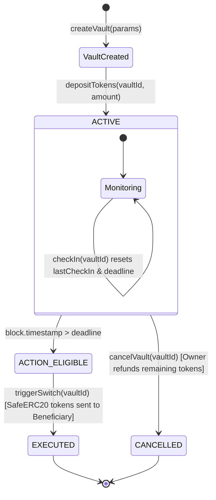

# Dead-Man Switch — Blockchain-Based Digital Contingency Vault

[](https://soliditylang.org/)
[](https://hardhat.org/)
[](https://nextjs.org/)
[](https://www.typescriptlang.org/)
[](https://tailwindcss.com/)
[](https://docs.ethers.org/v6/)
[](https://opensource.org/licenses/MIT)

An institutional-grade, zero-trust decentralized contingency vault and digital inheritance protocol developed for an MSc Computer Science blockchain project. The application allows individuals to lock digital assets or encrypted secrets behind an autonomous, on-chain proof-of-life mechanism.

If the owner fails to execute a cryptographic check-in before the configured deadline elapses, the smart contract permits designated beneficiaries or decentralized keepers to trigger the handover of assets according to immutable blockchain rules.

---

## 1. System Architecture & Flow



### Core Cryptographic Principles
1. **Autonomous Verification**: Smart contracts cannot execute themselves on a timer. The contract strictly checks `block.timestamp > lastCheckIn + checkInInterval` upon invocation.
2. **Independent Enforceability**: Once the deadline lapses, any wallet (including the beneficiary or keeper bots) can trigger the switch.
3. **No False Proof of Death**: The protocol verifies **inactivity**, not biological mortality or legal entitlement.
4. **Zero Plaintext Secrets**: Encrypted messages and documents are held off-chain (e.g. IPFS/Arweave). Only cryptographic hashes and encrypted payloads are referenced on-chain.

---

## 2. Smart Contracts Overview

### `DeadManSwitch.sol`
- **Reentrancy Protection**: Uses OpenZeppelin `ReentrancyGuard` on all state-modifying deposit, trigger, and cancellation routines.
- **Safe Token Transfers**: Employs OpenZeppelin `SafeERC20` for non-standard and standard ERC-20 tokens.
- **State Machine**:
  - `ACTIVE (0)`: Vault active, awaiting periodic owner check-ins.
  - `EXECUTED (1)`: Contingency switch triggered and assets transferred to beneficiary.
  - `CANCELLED (2)`: Vault cancelled by owner; deposited tokens refunded to owner.
- **Key Methods**:
  - `createVault(CreateVaultParams calldata params)`: Initializes vault parameters.
  - `depositTokens(uint256 vaultId, uint256 amount)`: Pulls approved ERC-20 tokens into contract escrow.
  - `checkIn(uint256 vaultId)`: Proof-of-life trigger restricted to vault owner.
  - `triggerSwitch(uint256 vaultId)`: Validates deadline and executes handover to beneficiary.
  - `cancelVault(uint256 vaultId)`: Allows owner to terminate an active vault and withdraw remaining balance.
  - `updateBeneficiary(uint256 vaultId, address newBeneficiary)`: Allows owner to re-assign heir.

### `TestToken.sol` (TEST)
- Standard ERC-20 token with 18 decimals (`"Test Token"` / `"TEST"`).
- Public faucet function: `faucet(address recipient)` allows any test wallet to claim **1,000 TEST** with a 1-minute anti-spam cooldown.
- Deployed locally and to testnets to avoid using real funds.

---

## 3. Automated Test Suite (Hardhat)

The smart contracts include an automated test suite verifying all 12 core requirements + bonus faucet test.

### Running the Tests
```bash
cd contracts
npx hardhat test
```

### Verified Test Scenarios:
| # | Test Scenario | Status |
|---|---|---|
| 1 | A user can create a vault with valid parameters | ✅ Passed |
| 2 | An invalid beneficiary address is rejected (0x0 or self) | ✅ Passed |
| 3 | Only the owner can check in | ✅ Passed |
| 4 | Check-in updates the last check-in timestamp and deadline | ✅ Passed |
| 5 | Triggering before the deadline fails | ✅ Passed |
| 6 | Triggering after the deadline succeeds | ✅ Passed |
| 7 | The beneficiary receives the configured token amount upon execution | ✅ Passed |
| 8 | The switch cannot execute twice | ✅ Passed |
| 9 | A cancelled vault cannot execute and refunds remaining tokens | ✅ Passed |
| 10 | Unauthorized users cannot change protected configuration | ✅ Passed |
| 11 | Token funding and allowance failures are handled correctly | ✅ Passed |
| 12 | Multiple vaults can exist without interfering with each other | ✅ Passed |
| 13 | TestToken faucet allows claiming 1,000 TEST with cooldown | ✅ Passed |

---

## 4. Local Quick Start Guide

### Prerequisites
- Node.js (v18+ or v20+)
- npm (v9+)
- MetaMask browser extension

### Step 1: Start the Local Hardhat Blockchain
Open a terminal in the root directory:
```bash
npm run chain
```
This starts a local Ethereum node at `http://127.0.0.1:8545` with 20 pre-funded test accounts (10,000 ETH each).

### Step 2: Deploy Smart Contracts
In a second terminal:
```bash
npm run deploy:local
```
This script:
1. Deploys `TestToken.sol`.
2. Deploys `DeadManSwitch.sol`.
3. Creates a 1-minute demo vault (`Vault #1`) and funds it with 100 TEST.
4. Funds the secondary beneficiary account with 1,000 TEST.
5. Automatically exports deployment addresses and contract ABIs to `frontend/src/contracts/`.

### Step 3: Start the Frontend Application
In a third terminal:
```bash
npm run dev:frontend
```
Open your browser and navigate to:
```
http://localhost:3001
```

---

## 5. MetaMask Configuration & Test Wallets

### Add Hardhat Local Network to MetaMask
- **Network Name**: `Hardhat Localhost`
- **New RPC URL**: `http://127.0.0.1:8545`
- **Chain ID**: `31337`
- **Currency Symbol**: `ETH`

### Import Pre-Funded Test Accounts into MetaMask
| Role | Address | Private Key |
|---|---|---|
| **Account #0 (Vault Owner / Deployer)** | `0xf39Fd6e51aad88F6F4ce6aB8827279cffFb92266` | `0xac0974bec39a17e36ba4a6b4d238ff944bacb478cbed5efcae784d7bf4f2ff80` |
| **Account #1 (Designated Heir / Beneficiary)** | `0x70997970C51812dc3A010C7d01b50e0d17dc79C8` | `0x59c6995e998f97a5a0044966f0945389dc9e86dae88c7a8412f4603b6b78690d` |
| **Account #2 (Third-Party Trigger / Keeper)** | `0x3C44CdDdB6a900fa2b585dd299e03d12FA4293BC` | `0x5de4111afa1a4b94908f83103eb1f1706367c2e68ca870fc3fb9a804cdab365a` |

---

## 6. End-to-End User Journey Walkthrough

1. **Connect Wallet**: Click "Connect Wallet" in the top bar using Account #0.
2. **Claim Faucet Tokens**: Click "Claim 1k TEST" in the header to mint 1,000 mock TEST tokens.
3. **Inspect Active Vault**: On the Dashboard, observe the live tabular monospace countdown for Vault #1.
4. **Perform Proof-of-Life Check-In**:
   - Click **"I'm Still Active"**.
   - Approve the transaction in MetaMask.
   - The contract resets `lastCheckIn` to the current block timestamp and extends the deadline.
5. **Simulate Deadline Expiration**:
   - Click **"Simulate Missed Deadline (Test Trigger)"** on the Dashboard.
   - This advances the Hardhat blockchain clock past the 60-second deadline.
   - The countdown transitions to **"DEADLINE LAPSED (TRIGGERABLE)"** with an emergency warning state.
6. **Trigger the Switch**:
   - Click the prominent **"Trigger Contingency Switch"** button.
   - Approve the on-chain execution transaction.
   - The contract transfers the 100 TEST tokens from the vault escrow directly into Beneficiary Account #1.
7. **Verify Outcome**:
   - Switch your MetaMask account to Account #1 (Beneficiary).
   - Check the TEST token balance in the header to confirm receipt.
   - Navigate to `/activity-log` to view the cryptographic event trail (`VaultCreated`, `VaultFunded`, `CheckedIn`, `SwitchTriggered`, `ActionExecuted`).

---

## 7. Optional Sepolia Testnet Deployment

To deploy to public Ethereum Sepolia:

1. Copy `.env.example` to `contracts/.env`:
   ```bash
   cp .env.example contracts/.env
   ```
2. Populate `SEPOLIA_RPC_URL`, `PRIVATE_KEY` (with a Sepolia funded key), and `ETHERSCAN_API_KEY`.
3. Deploy:
   ```bash
   npm run deploy:sepolia
   ```
4. Update the frontend network dropdown in the top-right corner to **Ethereum Sepolia**.

---

## 8. MSc Computer Science Project Details
- **Project Title**: Dead-Man Switch — Blockchain-Based Digital Contingency Vault
- **Academic Context**: Advanced Decentralized Systems & Smart Contract Security
- **Design System**: Obsidian Sentry (Tailwind CSS, Inter typography, JetBrains Mono tabular numerals, Dark Navy & Violet palette).
